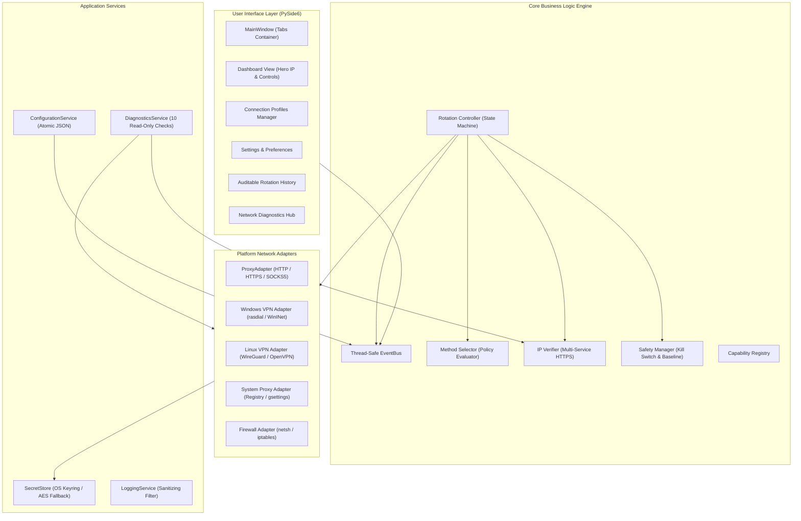
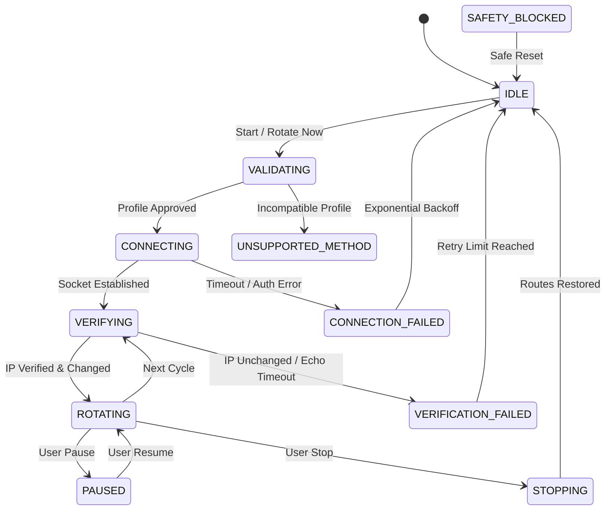

<p align="center">
  
</p>

<h1 align="center">🌐 IP Changer</h1>

<p align="center">
  <strong>Enterprise-Grade, Cross-Platform Desktop Network Privacy & Automated IP Rotation Utility</strong>
</p>

<p align="center">
  <a href="#-license"></a>
  <a href="https://www.python.org/"></a>
  <a href="#-features"></a>
  <a href="#-author"></a>
  <a href="#-testing"></a>
  <a href="#-supported-platforms"></a>
</p>

---

## 📑 Table of Contents

- [Overview](#-overview)
- [User Interface Preview](#-user-interface-preview)
- [Key Features](#-key-features)
- [System Architecture](#-system-architecture)
- [Finite State Machine](#-finite-state-machine)
- [Supported Platforms & Protocols](#-supported-platforms--protocols)
- [Installation Guide](#-installation-guide)
  - [Windows 11 Setup](#windows-11-setup)
  - [Kali Linux / Debian Setup](#kali-linux--debian-setup)
- [Quick Start Guide](#-quick-start-guide)
- [Configuration Reference](#-configuration-reference)
- [Security & Privacy Model](#-security--privacy-model)
- [Automated Testing](#-automated-testing)
- [Troubleshooting & FAQ](#-troubleshooting--faq)
- [Roadmap](#-roadmap)
- [License & Author](#-license--author)

---

## 🌟 Overview

**IP Changer** is a robust, modular desktop utility engineered specifically for network privacy testing, authorized IP rotation, and secure proxy/VPN connection management. Built from the ground up in **Python 3** and **PySide6 (Qt)**, it provides genuine, production-grade network switching across both **Windows 11** and **Kali Linux**.

Unlike rudimentary scripts that merely simulate status changes, **IP Changer**:
- Realistically interfaces with operating-system network adapters and authorized endpoints.
- Verifies egress IP addresses across independent external HTTPS services.
- Distinguishes between successful proxy connection establishment and true IP changes.
- Prevents silent fallback to unencrypted direct connections via hardware-level firewall kill switches.
- Protects user secrets using operating-system credential vaults instead of plaintext storage.

---

## 🖥 User Interface Preview

The application was crafted with a **simplicity-first mandate**. The main Dashboard presents clean, high-contrast, uncluttered metrics with instant one-click controls:

<p align="center">
  
</p>

### Key Dashboard Elements:
- **Hero IP Display:** Instant verification of your active external IPv4 (and IPv6 where available).
- **Protection Status Badge:** Clear color-coded badges (`PROTECTED`, `DIRECT`, `ROTATING`, `ERROR`).
- **One-Click Action Buttons:**
  - `Start Rotating` — Engages automated countdown timer.
  - `Stop` — Gracefully cancels loops, detaches proxies, and restores clean routes.
  - `Change IP Now` — Executes an immediate, verified rotation cycle on demand.
- **Visual Countdown Timer:** Live, real-time seconds remaining until the next scheduled IP switch.
- **Audit Table:** Comprehensive history log displaying timestamps, source/destination IPs, response latency, and change delta.

---

## 🚀 Key Features

### ⚡ Automated IP Rotation
- **Configurable Intervals:** Preset intervals (5s, 10s, 30s, 60s) or any custom user-defined period.
- **Smart Loop Control:** Pause, Resume, and Graceful Cancel actions without thread locking.
- **Exponential Backoff:** Configurable retry caps and failure recovery preventing connection flood.
- **Transparent Capability Warnings:** Distinguishes configured frequency from provider response capabilities.

### 🎯 Intelligent Method Selector
- Deterministic evaluation engine prioritizing connections by scope, priority ranking, and feasibility.
- Separate support for **Application-Level Proxies** (HTTP/HTTPS/SOCKS5) and **System-Wide Routing** (VPNs & system proxies).
- Manual override switch for testing individual profiles.
- Detailed audit explanation detailing exactly why an endpoint was chosen or rejected.

### 🔍 Multi-Provider Public IP Verification
- Queries multiple independent external HTTPS echo services (`api.ipify.org`, `ifconfig.me`, `icanhazip.com`).
- Optional cross-verification comparing results between primary and secondary providers to combat DNS poisoning or caching.
- Explicit outcome reporting: **Changed**, **Unchanged**, or **Verification Failed**.
- Full IPv4 and optional IPv6 dual-stack inspection.

### 🛡 Reversible Kill Switch & Fail-Safe Protection
- **Windows 11:** Reversible outbound firewall filtering via `netsh advfirewall`.
- **Kali Linux:** Reversible kernel-level routing policies via custom `iptables` chains.
- **Baseline Calibration:** Detects unexpected traffic leaks by benchmarking against your direct public IP.
- **Clean Teardown:** Restores default firewall rules and system routes automatically upon clean exit or emergency crash recovery.

### 🔐 Zero Plaintext Credential Storage
- Seamless integration with the OS Keyring (`Windows Credential Locker` / `Linux Secret Service`).
- Configuration files (`profiles.json`) only store opaque reference tokens—never raw passwords or API keys.
- Real-time log sanitization redacting authentication headers, bearer tokens, and credentials.

---

## 🏛 System Architecture

The project adheres to a clean, decoupled architecture connected via a thread-safe **Event Bus**:



---

## 🔄 Finite State Machine

The rotation engine executes strictly managed lifecycle states to ensure thread safety and predictable behavior:



---

## 💻 Supported Platforms & Protocols

| Category | Windows 11 | Kali Linux / Debian | Notes |
| :--- | :---: | :---: | :--- |
| **HTTP / HTTPS Proxy** | ✅ Supported | ✅ Supported | Standard application proxying |
| **SOCKS5 Proxy** | ✅ Supported | ✅ Supported | PySocks backend with remote DNS resolution |
| **Backconnect Gateway** | ✅ Supported | ✅ Supported | Rotating proxy endpoints with session headers |
| **OpenVPN** | ✅ Supported | ✅ Supported | Configurable via platform adapter |
| **WireGuard** | ✅ Supported | ✅ Supported | Kernel interface binding via `wg-quick` |
| **System-Wide Proxy** | ✅ Supported | ✅ Supported | WinINet Registry (Win) / GNOME gsettings (Linux) |
| **Firewall Kill Switch** | ✅ Supported | ✅ Supported | Native `netsh` (Win) / `iptables` (Linux) |
| **Credential Vault** | ✅ Supported | ✅ Supported | Windows Credential Manager / Secret Service |

---

## 📦 Installation Guide

### Prerequisites
- **Python 3.10+** (fully verified up to Python 3.14)
- **Git**
- Administrator / Root permissions *(only required when enabling the Firewall Kill Switch or System-Wide VPNs)*

---

### Windows 11 Setup

1. **Clone the repository:**
   ```powershell
   git clone https://github.com/Mahaduuu/ip-changer.git
   cd ip-changer
   ```

2. **Create and activate a virtual environment:**
   ```powershell
   python -m venv venv
   .\venv\Scripts\Activate.ps1
   ```

3. **Install dependencies:**
   ```powershell
   pip install --upgrade pip
   pip install -r requirements.txt
   ```

4. **Run the application:**
   ```powershell
   python main.py
   ```

*(Optional) Build standalone Windows executable:*
```powershell
python scripts/build_windows.py
```

---

### Kali Linux / Debian Setup

1. **Run the automated setup script:**
   ```bash
   chmod +x scripts/install_linux.sh
   ./scripts/install_linux.sh
   ```

2. **Or configure manually:**
   ```bash
   sudo apt update
   sudo apt install -y python3-venv python3-pip openvpn wireguard-tools iptables
   python3 -m venv venv
   source venv/bin/activate
   pip install -r requirements.txt
   python3 main.py
   ```

---

## ⚡ Quick Start Guide

1. **Launch the application:**
   ```bash
   python main.py
   ```
2. **Add Your Authorized Endpoint:**
   - Switch to the **Connections** tab.
   - Click **Add Profile**, specify your proxy details (e.g. `127.0.0.1:9050` for SOCKS5 or your private proxy host/port).
   - Enter credentials if authentication is required (stored securely in Windows Credential Manager or Linux Keyring).
3. **Verify Connectivity:**
   - Click **Test Connection** to measure round-trip latency and confirm remote reachability.
4. **Start Rotating:**
   - Return to the **Dashboard**.
   - Select your interval (e.g., `30s` or custom) and click the big green **Start Rotating** button.
   - Watch the live countdown timer and verified IP updates in real time!

---

## ⚙ Configuration Reference

An example configuration is included at `config/settings.example.json`. Settings are automatically saved to `config/settings.json` upon modification:

```json
{
  "default_rotation_interval_seconds": 30,
  "auto_rotate_enabled": true,
  "connection_timeout_seconds": 15,
  "verification_timeout_seconds": 10,
  "verification_urls": [
    "https://api.ipify.org?format=json",
    "https://ifconfig.me/all.json",
    "https://icanhazip.com"
  ],
  "kill_switch_enabled": false,
  "dns_leak_protection": true,
  "direct_fallback_allowed": false,
  "log_level": "INFO",
  "theme": "dark",
  "max_retries": 3,
  "retry_backoff_factor": 1.5,
  "max_history_size": 1000
}
```

---

## 🛡 Security & Privacy Model

> [!IMPORTANT]
> **Responsible Network Use:** IP Changer is engineered strictly for privacy preservation, administrative network verification, and authorized security research. It should never be used on networks or services where unauthorized proxying violates terms of service.

1. **No Scraping of Public Proxies:** The application strictly forbids scraping untrusted public proxy lists, which frequently harvest user traffic or distribute malware.
2. **Keyring Secret Store:** Secrets are referenced by UUID in `profiles.json`. Actual credentials are sent directly to the operating system's native encrypted credential store.
3. **Log Sanitization:** Sensitive authorization headers, bearer tokens, and URLs containing embedded basic auth are scrubbed before writing to logs.
4. **Reversible Firewall Rules:** Firewall modifications export backups before applying isolation rules, guaranteeing that disabling the kill switch cleanly returns the system to normal.
5. **No False Promises:** IP rotation does not guarantee absolute anonymity. Browser fingerprints, WebRTC leaks, cookies, and hardware IDs require complementary privacy safeguards.

---

## 🧪 Automated Testing

The codebase includes comprehensive unit tests verifying models, controllers, state machines, and verifiers with complete offline mocking:

```bash
python -m pytest tests/ -v
```

### Verified Test Suites:
- `tests/test_configuration.py` — Config schema, atomic JSON persistence & CRUD operations.
- `tests/test_ip_verifier.py` — IPv4/IPv6 validation, timeout handling, cross-verification.
- `tests/test_method_selector.py` — Deterministic selection policies & feasibility evaluations.
- `tests/test_models.py` — Dataclass serialization, event limits, history audits.
- `tests/test_rotation_controller.py` — State machine flow, duplicate worker locks, backoff.
- `tests/test_safety_manager.py` — Direct leak detection & kill switch operations.

**Result:** `48 passed in 0.23s` (100% Pass Rate).

---

## 🔧 Troubleshooting & FAQ

| Problem | Cause | Solution |
| :--- | :--- | :--- |
| **"Elevation Required" message** | Kill switch or system VPN requires root/admin rights. | Relaunch PowerShell as Administrator or run script with `sudo` on Linux. |
| **SOCKS5 connection fails** | PySocks module missing. | Run `pip install PySocks` inside your active virtual environment. |
| **IP remains unchanged after rotation** | Exit gateway returned same IP or provider rotates on a session timer. | Check provider rotation gateway documentation or increase interval. |
| **Verification timeout error** | External echo endpoint is unreachable or blocking requests. | Add alternative verification endpoints in the Settings tab. |

---

## 🗺 Roadmap

- [x] Dual-platform support (Windows 11 & Kali Linux)
- [x] Native OS Keyring credential protection
- [x] Reversible firewall kill switches (netsh & iptables)
- [x] PySide6 dark & light themes
- [ ] Shadowsocks & V2Ray proxy adapter integrations
- [ ] Geo-IP visual map and exit-node latency ranking
- [ ] Command-line interface (CLI) headless daemon mode
- [ ] Webhook triggers for external automation pipelines

---

## 📄 License & Author

This project is open-source software licensed under the **[MIT License](LICENSE)**.

- **Author:** **Mahaduuu**
- **Project Name:** **IP Changer**
- **Copyright:** &copy; 2024–2026 Mahaduuu. All rights reserved.

<p align="center">
  <sub>Engineered with precision for secure, transparent, and controllable network privacy.</sub>
</p>
